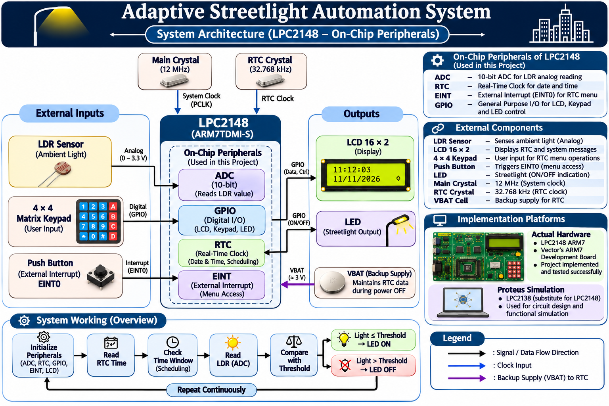
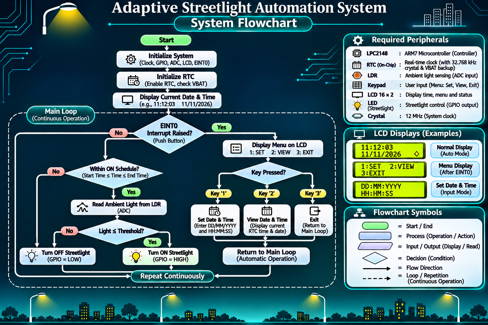

# Adaptive Streetlight Automation System

An embedded systems project that automates streetlight operation using scheduled time control and ambient light detection.

## Project Overview

The Adaptive Streetlight Automation System is developed using the LPC2148 ARM7 microcontroller. It combines Real-Time Clock (RTC) scheduling with an LDR-based ambient light detection mechanism to control streetlight operation.

The system operates within a configured time window. During this period, the LDR sensor monitors ambient light intensity and the controller switches the streetlight ON or OFF according to the configured threshold.

An external interrupt provides access to the RTC menu, allowing the user to set or view date and time information through a 4×4 matrix keypad.

## Features

- RTC-based time scheduling.
- Automatic streetlight control using ambient light detection.
- LDR interfacing through the on-chip ADC.
- LCD 16×2 display for date, time and system status.
- 4×4 matrix keypad for user input.
- External interrupt (EINT0) for RTC menu access.
- Support for time windows that cross midnight.
- RTC battery-backup support.
- Modular Embedded C firmware.

## Hardware Components

| Component | Purpose |
|---|---|
| LPC2148 ARM7 | Main microcontroller |
| LDR | Ambient light detection |
| LCD 16×2 | Displays date, time and menu |
| 4×4 Matrix Keypad | User input |
| Push Button | External interrupt input |
| LED | Represents streetlight output |
| 12 MHz Crystal | Main system clock |
| 32.768 kHz Crystal | RTC clock source |

## Software and Tools

- Embedded C
- Keil µVision
- Proteus ISIS
- LPC2148 ARM7 Development Board

## Working Principle

1. The microcontroller initializes the required peripherals.
2. The RTC maintains and provides the current date and time.
3. The LCD continuously displays RTC information during normal operation.
4. The scheduling module checks whether the current time falls within the configured operating window.
5. Outside the configured time window, the streetlight LED remains OFF.
6. During the active time window, the LDR sensor is read through the ADC.
7. The detected light level is compared with the configured threshold.
8. If the light level is greater than the threshold, the LED turns OFF.
9. If the light level is less than or equal to the threshold, the LED turns ON.
10. Pressing the external interrupt button opens the RTC menu on the LCD.

## RTC Menu

The RTC menu is accessed through the EINT0 external interrupt.

- Key 1 – Set date and time.
- Key 2 – View current date and time.
- Key 3 – Exit the menu and return to automatic operation.

Additional keypad inputs are used during the date and time setting process.

## System Architecture



## System Flowchart



## Proteus Simulation

The Proteus ISIS simulation uses LPC2138 as a substitute because LPC2148 is unavailable in the Proteus component library.

The embedded firmware is developed for LPC2148.

Simulation files and screenshots are available in the `Simulation` directory.

## Actual Hardware Implementation

The project has also been implemented and tested successfully on the actual LPC2148 development board.

Hardware photographs and LCD output photographs will be added to the `Images` directory.

## RTC Battery Backup Consideration

The LPC2148 RTC supports battery-backed timekeeping through its VBAT supply.

Fixed RTC initialization calls such as `SetRTCTimeInfo()` and `SetRTCDateInfo()` should not execute on every startup when retained RTC time is required. Otherwise, the previously stored date and time may be overwritten.

## Hardware and Simulation Notes

- Software delay values should be calibrated according to actual hardware clock settings.
- Proteus keypad number mapping may differ from the physical keypad layout.
- Verify keypad numeric mapping when adapting the simulation configuration to physical hardware.
- Proteus simulation uses LPC2138, whereas the actual firmware target is LPC2148.

## Repository Structure

```text
Adaptive-Streetlight-Automation/
│
├── Firmware/
│   ├── Keil_Project/
│   └── Source/
│
├── Hardware/
│   ├── Circuit_Diagram/
│   ├── Components/
│   └── Pin_Connections/
│
├── Simulation/
│
├── Documentation/
│   ├── System_Overview.txt
│   ├── Working_Principle.txt
│   ├── RTC_Battery_Backup.txt
│   ├── Module_Description.txt
│   ├── System_Architecture.txt
│   ├── System_Architecture.png
│   ├── System_Flowchart.txt
│   ├── System_Flowchart.png
│   ├── Testing_and_Verification.txt
│   └── Limitations_and_Future_Enhancements.txt
│
├── Images/
│   ├── Hardware/
│   ├── LCD_Outputs/
│   └── Simulation/
│
├── .gitignore
└── README.md
```

## Future Enhancements

- Wireless monitoring and remote control.
- Centralized monitoring of multiple streetlights.
- Fault detection for sensors and streetlight outputs.
- Energy consumption monitoring.
- IoT-based monitoring and reporting.

## Conclusion

The Adaptive Streetlight Automation System demonstrates embedded automation through RTC-based scheduling and ambient light detection using the LPC2148 ARM7 microcontroller.

The project combines peripheral interfacing, interrupt handling, ADC-based sensing, LCD interfacing and modular Embedded C programming.